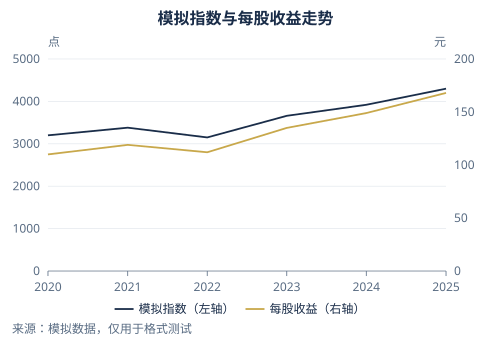

# iFAST Chart Skill

将已确认的金融研究图表流程打包为可移植的 Agent Skill：输出 HTML、SVG 和带可编辑绘图数据的原生 XLSX 图表。

包含 iFAST 配色主题（深海军蓝、哑金、浅灰底）、三档厘米尺寸、年度刻度、双轴、中文大数显示单位，以及生成和验收脚本。**不包含真实研究数据、本机路径、账号凭据或字体文件。** 配色由用户参考图衍生，并非官方品牌规范。



## 安装到 Agent

```text
git clone https://github.com/StevenWangYiLiang/ifast-chart-skill.git
```

将 `skills/ifast-charts` 整个文件夹复制到目标 Agent 的技能目录，例如：

- Codex：`~/.codex/skills/ifast-charts`
- Claude Code 个人技能：`~/.claude/skills/ifast-charts`
- 其他支持 `SKILL.md` 的 Agent：放入其技能目录；若不支持自动发现，直接让 Agent 读取该文件。

重启或重新加载技能后，可以说：

> 使用 ifast-charts，把这个 Excel 的数据按 iFAST 主题画成折线图，默认中号，输出 HTML、SVG、XLSX。

不需要安装到全局目录也可使用：向 Agent 提供本仓库 `skills/ifast-charts/SKILL.md` 的路径。

## 运行示例

依赖：Node.js 18+、Python 3.10+。XLSX 导出使用 XlsxWriter；HTML/SVG 只需 Node.js。字体需本机自行安装 HarmonyOS Sans SC / Light，或由用户明确指定替代。

若系统只有 `python3` 命令，将示例中的 `python` 替换为 `python3`，并给生成器增加 `--python python3`。

在仓库根目录运行：

```text
python -m pip install -r skills/ifast-charts/requirements.txt
node skills/ifast-charts/scripts/render.mjs --spec skills/ifast-charts/examples/mock-data.json --out outputs/demo
python skills/ifast-charts/scripts/verify.py outputs/demo
```

默认生成三张模拟图。输出含 `charts.html`、逐图 SVG、`charts.xlsx`、整理后数据和验收清单。已有文件时使用新的输出目录，或在授权修改范围内加 `--overwrite`。

Windows 有 Excel 时，可进一步校准并导出预览：

```text
powershell -NoProfile -File skills/ifast-charts/scripts/polish-excel.ps1 -OutputDirectory outputs/demo
python skills/ifast-charts/scripts/verify.py outputs/demo
```

## 规范

| 项目 | 默认要求 |
|---|---|
| 字体 | HarmonyOS Sans SC / Light，正文 9 磅、标题加粗 12 磅 |
| 大 / 中 / 小 | 19×9 / 13×9 / 9×6 cm，默认中号 |
| 图例 | 底部居中，必要时换行 |
| 日期横轴 | 每年 1 月 1 日主刻度线 |
| 纵轴 | 包含 0，4–7 个标签，按生成时数据计算 |
| 轴名 | 只有单位，横排放在轴上方，与刻度同色 |
| 大数值 | 超过 10 万后优先用万/百万/亿/万亿，不改绘图数据 |
| XLSX | 仅成图 Sheet，每页为原生图表和可编辑绘图数据 |

可选参数：`--size large|medium|small`、`--theme ifast` 或自定义 JSON 路径、`--formats html,svg,xlsx`、`--python <解释器>`。

新增风格只需复制 `assets/themes/ifast.json`，修改名称和配色；统一格式保存在 `assets/standards.json`。

## 能力边界与检查

自带生成器支持折线、分组柱状、非负堆积柱状图；不负责金融取数、投资判断或 PPTX。未知单位保留“未注明”，缺失值不补零。

跨平台生成器不依赖 Codex 私有运行时。Windows Excel 可精确校准单位位置；其他 Office/LibreOffice 环境仍需实际打开验收，不保证各版本像素一致。HTML/SVG 是快照，修改 Excel 后不会自动同步；数据超出当前范围时需重新生成。

测试：

```text
python -m unittest discover -s tests -v
```

详细入口：[SKILL.md](skills/ifast-charts/SKILL.md) · [输入规范](skills/ifast-charts/references/input-spec.md) · [验收规范](skills/ifast-charts/references/acceptance.md)
